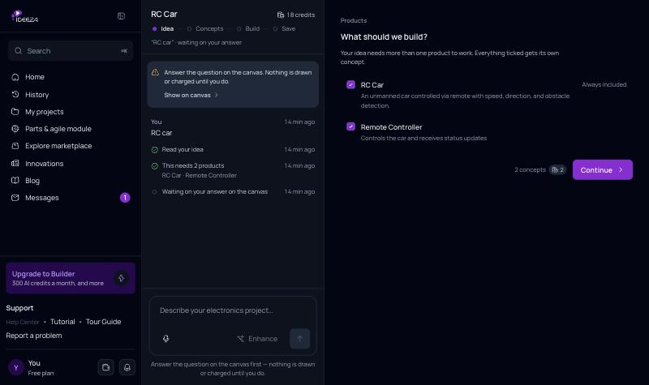
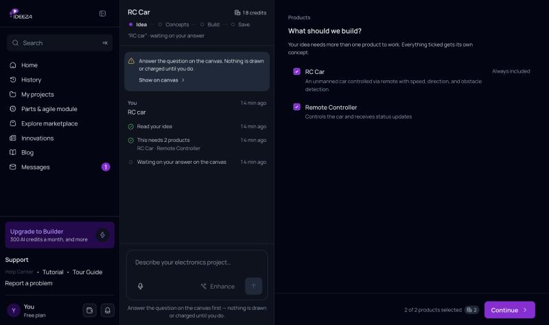

# Changelog

This is what changed in the live app (`main`), newest first. Every entry has
the same four parts:

- **Where** it shows up in the app.
- **The decision** the product owner made, and why.
- **What changed** for the person using the app: what it was before, and what it is now.
- **Before and after** screenshots, side by side.

Code changes are not listed here. They live in the git history. Work that is
only on `staging` and has not reached `main` is not listed either.

The log starts from the live app of 1 November 2026.

<!--
How to add an entry: an entry is written in the same merge that brings a
feature to main. Releases are grouped under the date they went live, newest
first. Screenshots go in docs/changelog/ and are named
<date>-<short-name>-before.png and <date>-<short-name>-after.png.

## 3 November 2026

### Products question: the total stays in view

**Where:** Concept chat › canvas › "What should we build?"

**Decision (owner, 3 Nov 2026):** The count, the price and the Continue button
are always visible at the bottom of the screen. The count shows how many
products are chosen out of how many the idea can have.

**What changed**

- **Before:** "2 concepts", the credits and Continue sat right under the list.
  A long list pushed them off the screen.
- **After:** they sit in a bar pinned to the bottom of the canvas, and the note
  reads "2 of 5 products selected".

| Before | After |
| --- | --- |
|  |  |
-->
